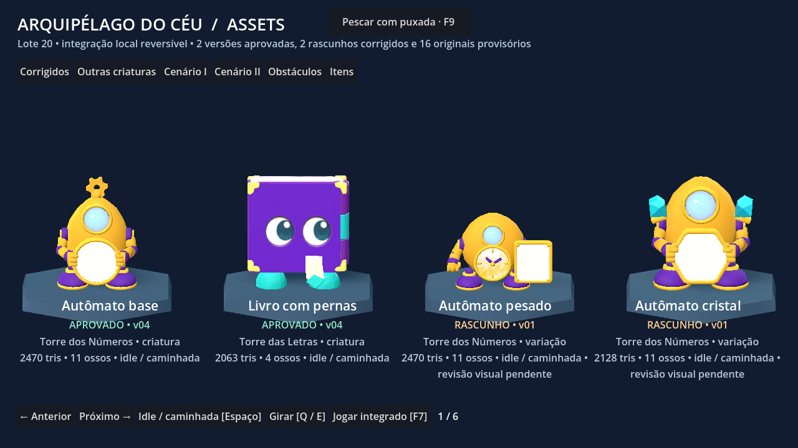

# Teste do lote Meshy de 19/10/2026

O lote tem **20 assets em 24 GLBs**, incluídos em `game/assets/modelos/meshy-teste-20261019/`. O teste usa cópias separadas: não sobrescreve o herói, as torres, os assets anteriores ou o save normal.

## Como testar e voltar

Com .NET SDK 8 e Godot 4.7.2 .NET configurados (ver README da raiz):

```powershell
.\tools\run.cmd --meshy-test
```

O comando compila, importa os recursos e abre o catálogo. **F7** ou “Jogar integrado” alterna catálogo/jogo, preservando a partida em memória. A barra inferior permite entrar diretamente nas duas torres. O teste usa `user://meshy-teste-20261019.json`; um `--save=...` explícito continua sendo respeitado para testes descartáveis. O modo existe somente em debug. Para voltar à apresentação anterior, abra normalmente com `.\tools\run.cmd`, sem `--meshy-test`.

No catálogo: abas ou setas esquerda/direita mudam a página, Espaço alterna idle/caminhada dos corrigidos e Q/E gira os modelos. No jogo: WASD/setas movem, Shift corre, E interage e F escolhe a criatura. O piloto `--driver=...` usa os assets, mas não abre o catálogo nem cria Perfil automaticamente.



## Mapeamento e escopo

As fontes são [prompts-meshy.md](../prompts-meshy.md), [guia de estilo visual](../../guia-de-estilo-visual.md) e a folha/JSON de `origin/feat/199-folha-de-pedidos-meshy`, commit `0834c507ea0a2f492c107d88d3433203fd731a10`. As cópias históricas estão em [folha-de-pedidos-origem.md](folha-de-pedidos-origem.md) e [pedidos-origem.json](pedidos-origem.json). Seus comentários sobre aprovação são históricos; o estado atual é o da tabela abaixo e do catálogo.

| Assets | Uso no teste |
| --- | --- |
| Autômato base v04 e livro com pernas v04 | Criaturas da Torre dos Números e da Torre das Letras, respectivamente. Seguem o deslocamento real do combate, alternando idle/caminhada. |
| Autômato pesado v01 e autômato cristal v01 | Variações corrigidas no catálogo, ainda como rascunhos com revisão visual pendente. |
| Porta em arco | Portas existentes entre salas. Mantém painel trancado, bloqueio lógico e interação. |
| Escada de pedra | Escada principal de entrada/saída de Andar, na posição existente. Escada lateral mantém o visual anterior. |
| Fonte de Descanso | Ponto existente no centro da sala. O texto distingue fonte disponível/usada. |
| Pedestal mestre | Base decorativa no ponto existente do Desafio mestre do Lobby, preservando estrutura/interação. |
| Parede baixa, pilar, caixote, pilhas, itens e outras criaturas | Importados e acessíveis no catálogo com os usos da folha. Não foram distribuídos pelas salas sem posição/ligação definida no código atual. |

## Status visual e limitações

- Base/livro usam exclusivamente as versões corrigidas v04: 2.470 tris/11 ossos e 2.063 tris/4 ossos. A direção visual dessas versões foi aprovada na revisão local.
- Pesado/cristal usam exclusivamente as versões corrigidas v01: 2.470 tris/11 ossos e 2.128 tris/11 ossos. Foram reimportados e conferidos tecnicamente no Godot; **não estão aprovados visualmente**.
- Os outros **16 assets são originais rejeitados e provisórios**, claramente identificados na interface. Papel tem olhos vazios, pilha de livros tem deformações, engrenagens não têm suporte e fonte tem água insuficiente. Material mais fosco não corrige esses defeitos.
- Os GLBs incluem todos os dados necessários; não dependem dos diretórios locais usados na produção. Não incluem os rigs Meshy antigos nem exigem `.blend` para rodar.
- As cópias preservam geometria, rig e clipes. Usam apenas albedo, metallic 0 e rugosidade 0,78; texturas até 1024 px para criaturas e 512 px para props. Os 24 GLBs totalizam aproximadamente 4,6 MB. [importacao.json](../../../../game/assets/modelos/meshy-teste-20261019/importacao.json) registra proveniência, hashes, triângulos e clipes.
- Ajuste uniforme pela AABB importada: eixo Y vertical, centro horizontal e base no chão. Criaturas até 1,6 de largura/1,7 de altura; portas até 1,9 de largura; escada/fonte até 1,7/1,8 de largura.
- Navegação e colisões continuam usando o HexGrid existente. Não foi adicionada colisão automática à malha nem física de degraus. As animações são in-place; calibração fina de pés/velocidade ainda está pendente. Não houve fusão de malhas nem retarget.

## Validação

Compilação sem avisos/erros, testes de regra/arquitetura, formatação, comentários e diff sem erros. Os roteiros existentes `e2e-3`/`e2e-4`, com `--meshy-test`, seed 1 e save descartável, passaram pelo Nível 1 e reabriram o Nível 2, conferindo ambas as torres, Descanso, Puzzle, Fast travel, Item, Marco, escadas, épico e Desafio mestre. Esses processos de teste emitiram um aviso de uma instância ObjectDB ao encerrar.

O importador carregou os 24 GLBs. O validador abaixo confere triângulos, eixos/bounds e os oito ciclos corrigidos em 49 amostras; as poses foram finitas e os endpoints coincidiram. Isso não substitui revisão estética ou naturalidade. Os resultados estão em [godot-reimport-validation.json](godot-reimport-validation.json).

```powershell
& $env:GODOT --headless --path game --script res://Dev/MeshyTest/validate_meshy.gd -- --report=$env:TEMP/meshy-validacao.json
```

Nenhuma chamada paga ao Meshy é necessária para importar ou testar este PR.
